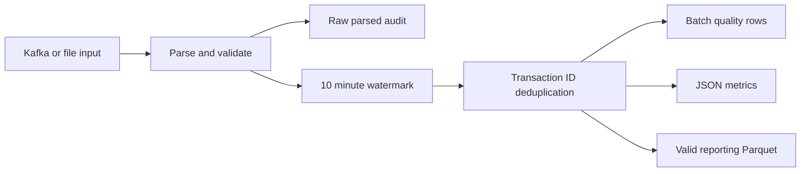

# Streaming Transaction Quality Monitor

[](https://github.com/jairajvk07/streaming-transaction-quality-monitor/actions/workflows/tests.yml)

A Kafka and Spark Structured Streaming pipeline for auditing transactions, removing duplicates within bounded state, identifying invalid records, and producing reporting datasets and quality metrics.

## Architecture



## Quick start without Kafka

Requires Python 3.10 or 3.11 and Java 17. Run commands from this directory. Linux, macOS, or WSL2 is recommended.

```sh
python -m venv .venv
# Activate .venv for your shell, then:
python -m pip install -r requirements.txt
python -c "from pathlib import Path; import shutil; Path('input').mkdir(exist_ok=True); shutil.copyfile('sample_transactions.jsonl','input/transactions.jsonl')"
spark-submit --master local[2] stream.py --source files --input input --seconds 30
```

## Run with Kafka

```sh
docker compose up -d
spark-submit --master local[2] --packages org.apache.spark:spark-sql-kafka-0-10_2.12:3.5.3 stream.py --source kafka --seconds 120
# In a separate terminal, after the broker is ready:
python producer.py
```

The producer runs on the host and publishes the synthetic fixture with six-second pauses. The development broker advertises localhost:9092 and auto-creates the transactions topic. Stop it with `docker compose down`; inspect `docker compose logs kafka` for startup problems.

## Quality and event-time semantics

- Required transaction ID and event timestamp.
- Positive, finite amount and USD currency.
- Ten-minute event-time watermark with transaction-ID deduplication within retained state.
- Invalid business records remain in deduplicated quality rows; valid rows enter reporting output.
- Null IDs and timestamps remain in parsed audit output but cannot enter stateful processing.

Watermarking bounds memory, rather than guaranteeing forever-global uniqueness. Very late events may be dropped. File mode reads the fixture in one microbatch and therefore demonstrates quality and deduplication, not prior-batch late-event dropping. The paced Kafka producer advances event time across batches; arrival scheduling affects the observed drop. Check `stateOperators[].numRowsDroppedByWatermark` in saved Spark progress. Production late-event correction needs an explicit replay path from retained audit data.

## Outputs and recovery

`output/streaming/audit/` stores parsed inputs. `batches/<batch_id>/` contains quality rows, JSON metrics, and valid-only Parquet. `spark-progress.json` records graceful-shutdown progress. Checkpoints preserve source offsets and streaming state.

Deterministic batch paths support replay of a batch with its checkpoint. They do not atomically commit all sinks. Keep checkpoint and output together, avoid consuming partial batches, and use a new output directory for a fresh demo. JSON metrics count retained deduplicated rows; malformed source bytes are not retained in this sample audit.

## Tests

```sh
python -m unittest discover -v
RUN_SPARK_TESTS=1 PYSPARK_SUBMIT_ARGS="--master local[2] --conf spark.sql.shuffle.partitions=4 pyspark-shell" python -m unittest discover -v
```

In PowerShell set RUN_SPARK_TESTS and PYSPARK_SUBMIT_ARGS with `$env:` before running unittest. Tests cover duplicate and late fixture data, watermark drops across microbatches, invalid amount labeling, deduplication, and audit counts. GitHub Actions executes Spark tests with Java 17 and Python 3.11. Kafka broker connectivity is not covered by these tests.

## Deployment and limitations

This portfolio demonstration processes synthetic transactions. It is a data-quality monitor, not a fraud model. The reporting Parquet schema can be staged for Snowflake; there is no deployed Snowflake integration. Production use requires decimal money types, durable checkpoints, TLS/SASL, a schema registry, raw dead-letter retention, reconciliation, and multi-sink commit coordination. No employer code, private data, or production performance claims are included.

## Files

`stream.py` — streaming processing and sinks.  
`producer.py` — paced synthetic Kafka producer.  
`sample_transactions.jsonl` — duplicate, invalid, and late-event fixtures.  
`compose.yaml` — local Kafka broker.  
`test_project.py` — fixture and Spark integration tests.

[Portfolio](https://jairajvk07.github.io/)
